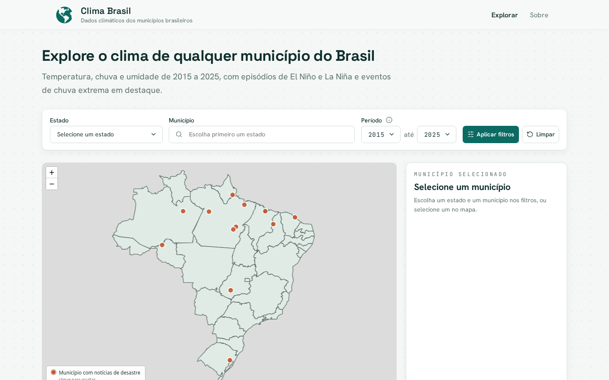
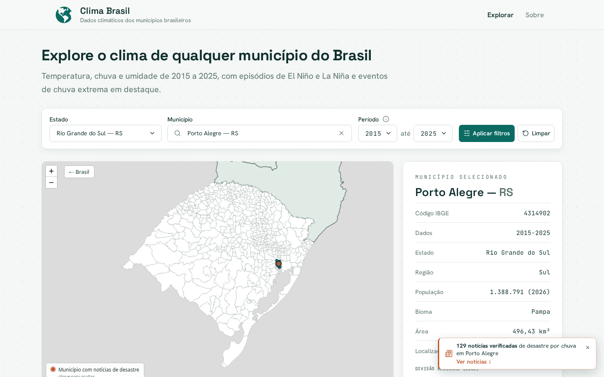
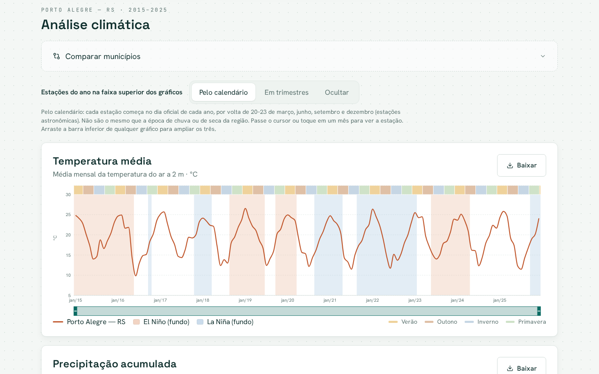
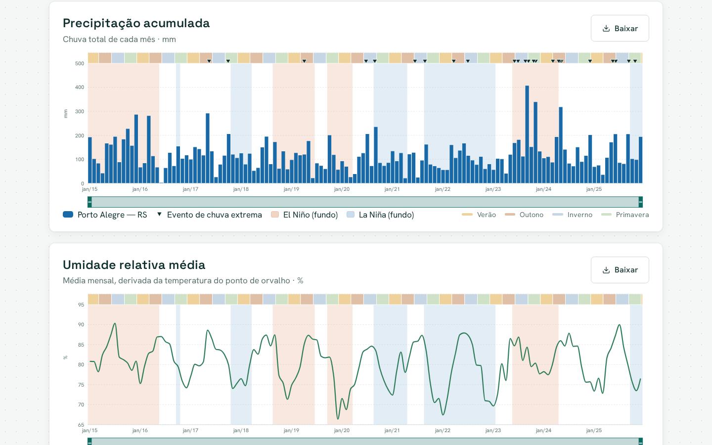
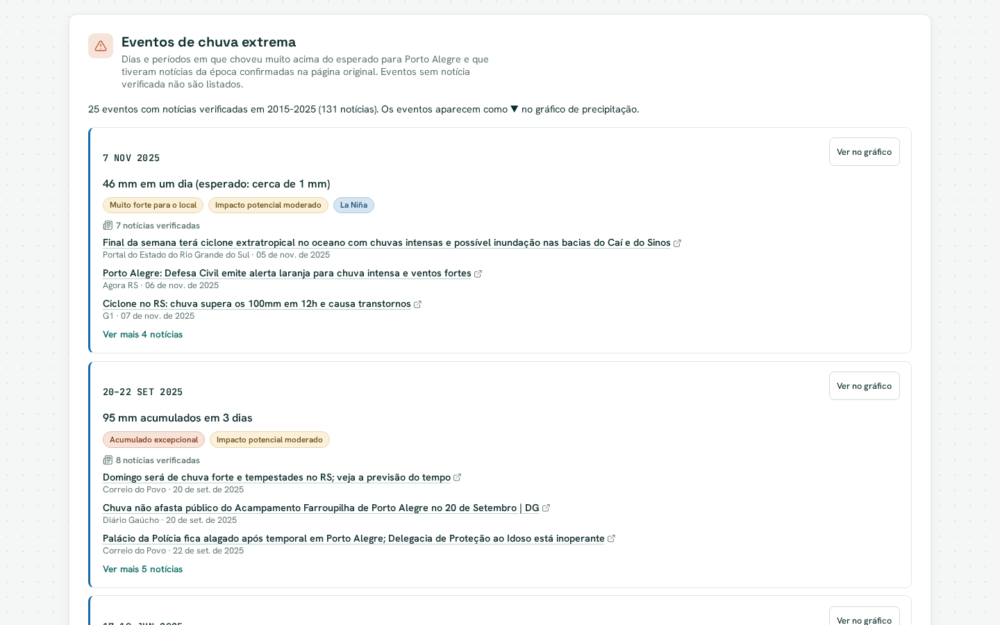
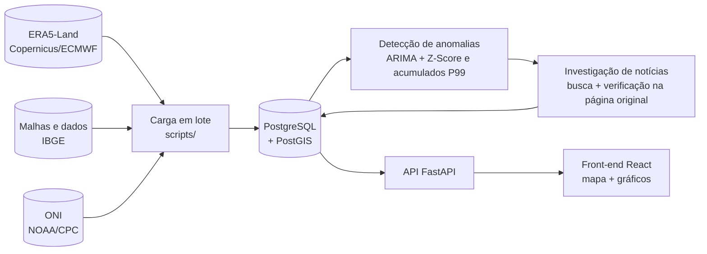

# Clima Brasil

**Plataforma de consulta e visualização do histórico climático dos municípios
brasileiros, com episódios de El Niño e La Niña e eventos de chuva extrema
confirmados por notícias da época.**

Projeto Integrador 2: o tema é o fenômeno El Niño e o produto é uma plataforma de
relatório do histórico climático. O Clima Brasil transforma dez anos de dados de
reanálise (2015–2025) em gráficos acessíveis. Assim, estudantes, educadores,
pesquisadores e pessoas curiosas podem conhecer e comparar o clima de qualquer
município do país.



## Funcionalidades

- **Mapa interativo dos 5.570 municípios.** Clique em um estado para ver os
  municípios dele e em um município para abrir os dados. A busca por estado e
  município faz o mesmo pelos filtros.
- **Pontos de notícias de desastre.** Municípios com notícias verificadas de
  desastre por chuva aparecem como pontos no mapa. Ao clicar na legenda, os
  pontos são ocultados ou exibidos de novo.
- **Ficha do município.** Código IBGE, população, bioma, área, localização,
  divisão regional e relevo (IBGE), com o nome fixo e os dados em rolagem.
- **Séries climáticas mensais.** Temperatura média, precipitação acumulada e
  umidade relativa, com:
  - faixas de **El Niño** e **La Niña** (índice ONI da NOAA) ao fundo;
  - faixa das estações do ano;
  - zoom sincronizado entre os três gráficos;
  - comparação com outro município;
  - download dos dados em CSV.
- **Eventos de chuva extrema com notícias confirmadas.** Dias e períodos com
  chuva muito acima do esperado, detectados estatisticamente e marcados (▼) no
  gráfico de precipitação. Cada evento lista as notícias da época, conferidas na
  página original. Eventos sem notícia verificada não aparecem.
- **Aviso de notícias.** Ao selecionar um município com notícias, um aviso
  leva direto para a lista de eventos e matérias.

| Município selecionado | Análise climática |
|---|---|
|  |  |

| Precipitação e eventos extremos | Notícias verificadas por evento |
|---|---|
|  |  |

## Como funciona



1. **Dados climáticos.** A reanálise [ERA5-Land](https://cds.climate.copernicus.eu/)
   (grade de ~9 km) fornece temperatura, ponto de orvalho e precipitação. Cada
   município é associado à célula mais próxima do seu centróide. A umidade
   relativa é calculada a partir da temperatura e do ponto de orvalho.
2. **El Niño e La Niña.** Episódios identificados pelo Índice Oceânico Niño
   (ONI): anomalia de pelo menos +0,5 °C (El Niño) ou de no máximo −0,5 °C
   (La Niña) por cinco trimestres consecutivos.
3. **Eventos de chuva extrema.**
   - Um modelo ARIMA prevê a chuva de cada dia; o dia entra como anomalia quando
     o escore Z passa de 3.
   - Somas de 3 e 5 dias acima do percentil 99 capturam episódios longos, como
     a enchente de maio de 2024 no RS.
   - Cada caso passa por uma revisão científica.
4. **Notícias.**
   - Para cada evento, matérias publicadas de 3 dias antes a 7 dias depois são
     buscadas e verificadas na página original: manchete, fonte, data, tema e
     município.
   - Só as notícias aprovadas chegam à plataforma.
   - Detalhes: [arquitetura do sistema de anomalias e notícias](docs/anomalias_noticias/ARQUITETURA.md)
     e [relatório de validação](docs/anomalias_noticias/RELATORIO_VALIDACAO.md).

> Os valores são estimativas de modelo, não medições de uma estação local. As
> faixas de El Niño e La Niña ajudam a explorar coincidências nas séries, mas não
> indicam sozinhas uma relação de causa e efeito.

## Tecnologias

| Camada | Ferramentas |
|---|---|
| Front-end | React 19, TypeScript, Vite, Leaflet / React-Leaflet, Recharts |
| API | FastAPI, SQLAlchemy 2, Alembic, Pydantic |
| Banco | PostgreSQL 17 + PostGIS 3.5 (Docker) |
| Dados e análise | xarray, cfgrib/ecCodes, GeoPandas, pandas, statsmodels, Marimo |
| Gerenciamento | `uv` (Python), `npm` (front-end) |

## Como executar

Pré-requisitos: Python 3.12+, [`uv`](https://docs.astral.sh/uv/), Docker e
Node.js 20+.

```sh
# 1. dependências e banco
uv sync
docker compose up -d postgis
uv run alembic upgrade head

# 2. dados (municípios, ERA5-Land e ONI): veja o guia completo abaixo
uv run codigo pipeline

# 3. API em http://127.0.0.1:8000 (documentação em /docs)
uv run uvicorn app.main:app --reload

# 4. front-end em http://localhost:5173 (em outro terminal)
cd front-end
npm install
npm run dev
```

O passo a passo completo de carga dos dados, a configuração do banco, a CLI e a
análise exploratória estão em **[docs/execucao-backend.md](docs/execucao-backend.md)**.
Para a detecção de anomalias e a investigação de notícias, veja
[docs/anomalias_noticias/README.md](docs/anomalias_noticias/README.md).

Testes do backend:

```sh
uv run pytest
```

## Estrutura do repositório

```
app/                 API FastAPI (municípios, clima, anomalias e notícias)
  climate_news/      detecção de anomalias, agentes de investigação e rotas /api/climate
alembic/             migrações do banco
scripts/             download e carga de municípios, ERA5-Land e ONI
src/codigo/          CLI e pipeline (`uv run codigo ...`)
front-end/           aplicação React (Vite)
analises/            notebooks de análise exploratória (Marimo)
docs/                documentação e imagens
tests/               testes automatizados
```

## Equipe

<table>
  <tr>
    <td align="center">
      <br>
      <b>Filipe Nascimento Soares</b><br>
      <a href="https://www.linkedin.com/in/filipe-nascimento-57659b1b5/">LinkedIn</a>
    </td>
    <td align="center">
      <br>
      <b>Guilherme Marinheiro de Oliveira</b><br>
      <a href="https://www.linkedin.com/in/guilherme-marinheiro-de-oliveira-8b7911329/">LinkedIn</a>
    </td>
  </tr>
</table>

## Fontes de dados

- **ERA5-Land**: Copernicus Climate Change Service / ECMWF (reanálise horária, ~9 km).
- **ONI**: NOAA Climate Prediction Center.
- **Malhas municipais, população, divisão regional e geomorfologia**: IBGE.
- **Notícias**: veículos de imprensa, com link para a matéria original.
