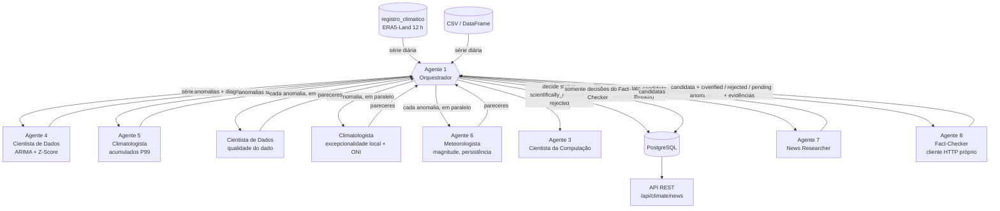
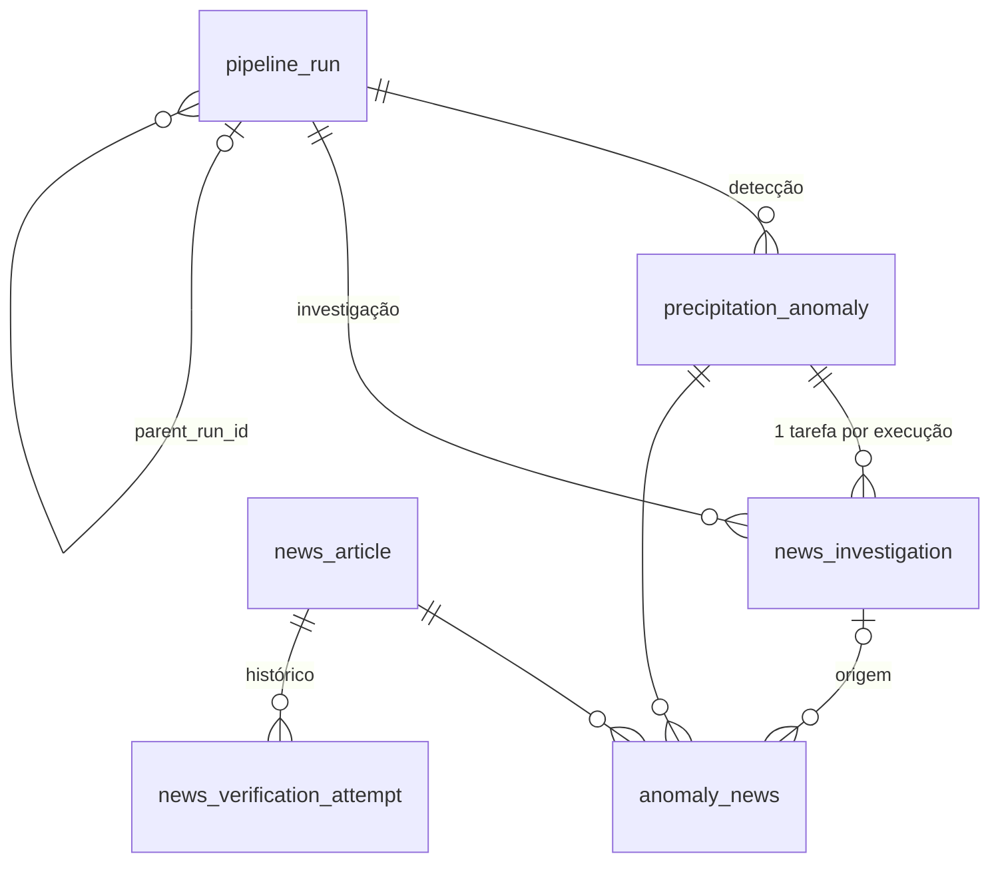

# Arquitetura — anomalias de precipitação e investigação de notícias

## 1. Visão geral

O sistema relaciona **anomalias estatísticas de precipitação** a **evidências
jornalísticas reais**, com rastreabilidade de cada decisão. Ele roda sobre a
plataforma existente (PostGIS com dados ERA5-Land e API FastAPI) e fica no pacote
`app/climate_news/`.

```
app/climate_news/
├── detection/            # sem banco; pode ser usado como script independente
│   ├── preparation.py    # Etapa 1: limpeza e regularização da série diária
│   ├── arima_zscore.py   # Etapas 2–4: ARIMA + Z-Score (script: python -m ...)
│   └── accumulation.py   # detector suplementar de acumulados (Climatologista)
├── agents/               # um módulo por agente (responsabilidade única)
│   ├── orchestrator.py   # Agente 1
│   ├── computer_scientist.py, data_scientist.py, climatologist.py,
│   ├── meteorologist.py, news_researcher.py, fact_checker.py
│   └── base.py           # AgentReport, MunicipalityContext
├── news/                 # infraestrutura de notícias
│   ├── http.py           # cliente HTTP com limite por host e novas tentativas
│   ├── google_news.py    # provedor de busca (Google News RSS + decodificação de links)
│   ├── extract.py        # metadados da página (Open Graph, JSON-LD, <time>)
│   └── text.py           # normalização, URLs, vocabulário, datas no texto
├── data_source.py        # série diária do banco, contexto municipal (vizinhos, homônimos), ONI
├── models.py             # SQLAlchemy (migração alembic 9f764edda274)
├── repository.py         # persistência; impede aprovação sem o Fact-Checker
├── router.py, schemas.py # API REST /api/climate/*
└── cli.py                # detect | investigate | run | resume | show
```

O **Agente 2 (Engenheiro de Software)** corresponde a essa organização em
camadas, à persistência e à API. Na execução, ele aparece como responsável pela
persistência nas execuções de investigação. O **Agente 3 (Cientista da
Computação)** atua como auditor: registra o hash da entrada, as versões, os
custos e as limitações de cada execução.

## 2. Comunicação entre agentes



Regras de coordenação:

- **Ninguém valida o próprio trabalho.** O News Researcher só produz candidatas
  `discovered`. O Fact-Checker acessa cada página de novo com seu **próprio**
  cliente HTTP e confere manchete, fonte e data na página, sem aceitar o que o
  buscador informou. A regra também está no banco: um `CHECK` impede
  `verification_status = 'verified'` sem `verified_by = 'fact_checker'`, sem
  evidência, sem data de publicação ou sem fonte.
- **Conflitos.** O status científico de uma anomalia vem da combinação dos três
  pareceres (`decide_scientific_status`). Quando Climatologista e Meteorologista
  divergem, a anomalia continua candidata, com a ressalva registrada. Quando uma
  mesma notícia é aprovada para uma anomalia e rejeitada para outra (por janela
  ou município), o status global é `verified` e cada vínculo guarda sua própria
  decisão. Se a própria página falha (404, manchete divergente), o status global
  passa a refletir essa falha.
- **Paralelismo.** As revisões científicas rodam em pool de 4 threads e as
  investigações em pool configurável (`--workers`). O cliente HTTP limita a taxa
  por host (news.google.com: 1 requisição a cada 1,5 s; demais hosts: 1 por
  segundo) e tenta de novo, com backoff, em erros 429/5xx. A gravação no banco é
  serializada por lock para evitar disputa na unicidade de URL.
- **Completude.** Cada data candidata vira uma linha `news_investigation`. A
  execução só termina como `completed` se todas as investigações terminaram; do
  contrário fica `failed`, com as datas listadas em `failed_dates` e
  `unprocessed_dates`, e `resume` reprocessa apenas o que faltou.

## 3. Detecção (Cientista de Dados e Cientista da Computação)

| Etapa | Implementação |
|---|---|
| Preparação | datas normalizadas para o dia UTC; série ordenada e reindexada em frequência diária; dia ausente vira NaN (nunca 0); duplicatas iguais são consolidadas e conflitantes viram NaN; valores negativos ou acima de 1000 mm/dia viram NaN; acima de 400 mm/dia o valor é mantido e sinalizado como suspeito |
| ERA5 12 h → diário | total do dia D = P(D 12Z) + P(D+1 00Z); se uma das metades falta, o dia fica ausente (é o caso do último dia de cada mês, pela lacuna de 00Z no dia 1º) |
| Transformação | `log1p` |
| Estacionariedade | ADF + KPSS no treino inicial; `d = 1` só se os dois indicarem raiz unitária |
| Sazonalidade | regressores de Fourier anuais (K = 3) com erros ARMA. A inclusão é decidida por BIC contra o modelo sem sazonalidade. SARIMA com s = 365 foi avaliado e descartado: o estado teria ~365·(P+Q) dimensões |
| Ordem | grade p, q ∈ {0, 1, 2}, escolhida por BIC no treino inicial (2 anos) |
| Fora da amostra | janela expansiva com reajuste anual: o ano Y usa parâmetros estimados com dados < Y, e a previsão de t usa observações até t−1 (teste `test_no_future_information_leaks_into_past_scores`) |
| Z-Score | μ_e e σ_e calculados nos resíduos de um passo do treino do próprio bloco (passado), descartando 30 dias de burn-in |
| Classificação | Z > 3 → `statistical_anomaly_above_expected`; Z < −3 → `..._below_expected`; severidade por \|Z\| (3–4, 4–5, ≥ 5); anomalias a até 1 dia uma da outra formam o mesmo episódio |

**Detector suplementar de acumulados.** O ARIMA mede surpresa em relação ao
passado recente, e chuva persistente acaba prevista pelo próprio modelo. Por
isso o Climatologista sinaliza somas de 3 e 5 dias acima do P99 dos anos
anteriores. Esses registros levam `detector = accumulation_percentile` e
**não se misturam** com as anomalias do ARIMA. Pode ser desligado com
`--no-accumulation`.

## 4. Revisão científica

| Agente | Avalia | Veredito |
|---|---|---|
| Cientista de Dados | qualidade do dado no dia (traço < 1 mm, dia anterior ausente) | `data_ok` / `possible_artifact` |
| Climatologista | percentis do volume entre os dias chuvosos da série e da época (±15 dias) no período anterior; estação chuvosa local; fase do ONI (como contexto, não como causa) | `exceptional_for_location`, `very_heavy_for_location`, `unusual_for_season`, `within_normal_variability`, `record_accumulation`, `exceptional_accumulation` |
| Meteorologista | máximo diário, acumulados de 3 e 5 dias centrados, dias chuvosos consecutivos, faixas de referência do INMET, hipóteses de mecanismo **marcadas como não confirmadas** | `plausible_extreme_event`, `plausible_significant_event`, `low_meteorological_significance` |

Anomalia **estatística** e evento **meteorológico extremo** ficam em campos
separados (`classification` e `scientific_review.reviews`). Nenhuma anomalia é
tratada como desastre.

## 5. Investigação e verificação

**Consultas** (Google News RSS, pt-BR, com `after:`/`before:`):

1. `"Município" (chuva OR temporal OR enchente OR alagamento OR inundação OR deslizamento OR granizo OR vendaval OR tempestade OR transbordamento)`
2. `"Município" "Defesa Civil"`
3. `("Vizinho1" OR "Vizinho2" OR "Vizinho3") (chuva OR temporal OR …)`; os vizinhos vêm de `ST_Touches`, ordenados por população

Para municípios homônimos, o nome do estado entra na consulta e passa a ser
exigido no texto. A janela padrão vai de 3 dias antes a 7 dias depois da
anomalia e é configurável.

**Critérios do Fact-Checker**, nesta ordem (falha conclusiva → `rejected`;
impossível confirmar → `pending_verification`):

1. URL de matéria específica: rejeita página inicial, busca, tag, listagem e agregador
2. página existe: 404/410 → rejeitada; rede, 403 ou 5xx → pendente
3. manchete alegada coincide com o título ou `<h1>` da página (sobreposição de tokens ≥ 0,6)
4. fonte identificada (`og:site_name` → publisher JSON-LD → domínio) e classificada como oficial, agência, veículo reconhecido ou regional
5. data de publicação lida na página (meta `article:published_time`, JSON-LD, `<time>`; por último, data visível em elemento de data, com confiança menor). Divergência com a data do buscador é registrada e prevalece a da página
6. relação temática: termo de evento de chuva na manchete, ou ao menos 2 termos distintos no texto
7. relação geográfica: o município aparece no texto (→ `relevant`) ou só um vizinho aparece (→ `regional`)
8. relação temporal: publicação dentro da janela; manchete que cita outro ano é tratada como retrospectiva e rejeitada; a data do evento é estimada pelo texto ("desta segunda-feira", "3 de maio", "ontem")
9. duplicação: mesmo canonical → mesma linha no banco (`same_article`); mesma manchete e data em outra URL → `republication`
10. confiabilidade: `high` (fonte oficial, agência ou veículo reconhecido, com data em metadado), `medium` ou `low`

Três datas ficam sempre separadas: **anomaly_date** (detecção),
**event_date** (estimada a partir do texto, no vínculo) e **published_at** (lida
na página).

## 6. Modelo de dados



| Tabela | Conteúdo principal |
|---|---|
| `pipeline_run` | id (UUID), `run_type` (detection/investigation), status (pending/processing/completed/failed), `algorithm_version`, `parameters` (ARIMA, limiar, janela…), período, `agents`, `summary` (datas detectadas, diagnósticos, contagens), `errors` |
| `precipitation_anomaly` | data, município/UF/IBGE, detector, observado, previsto, resíduo, Z, direção, severidade, classificação, episódio, status (detected/scientifically_reviewed/rejected), `model_params`, `scientific_review` (3 pareceres + decisão) |
| `news_investigation` | uma por (execução, anomalia): status, janela, consultas, fontes consultadas, contagens, erros, tentativas |
| `news_article` | id, **url** (normalizada, única), original/canonical, **headline**, **source**, domínio, **published_at**, `verification_status`, evidência, confiabilidade, `verified_by`, tentativas, origem da descoberta |
| `anomaly_news` | vínculo N:N: **anomaly_date** (via anomalia), **event_date**, **municipality** (via anomalia), **relevance_status**, `link_status`, decisão completa do Fact-Checker |
| `news_verification_attempt` | histórico de cada verificação: agente, decisão, HTTP, motivos e critérios |

Os campos pedidos para a notícia que dependem da anomalia (`anomaly_date`,
`event_date`, `municipality`, `relevance_status`) ficam no vínculo, porque uma
mesma notícia pode estar ligada a várias anomalias. A API devolve tudo junto.

## 7. Complexidade e escalabilidade (Cientista da Computação)

- Ajuste ARIMA: O(n·m²) por avaliação da verossimilhança (filtro de Kalman,
  m ≤ 3). Uma execução faz ~17 ajustes na seleção e ~9 reajustes anuais, o que
  dá cerca de 50–90 s por município com 11 anos (medido).
- Leitura do banco: a consulta usa `ORDER BY codigo_ibge, datetime` para seguir
  a chave primária. Com `ORDER BY datetime`, o planejador preferia o índice por
  data e varria a tabela inteira (~8 GB), passando de 5 minutos; agora leva
  ~0,6 s.
- Investigação: o gargalo é o limite de taxa do buscador (1,5 s por requisição
  ao news.google.com, com ~2 requisições por candidata para decodificar o
  link). O custo é linear no número de datas × candidatas.
- Reprodutibilidade: hash SHA-256 da série de entrada, versões das bibliotecas
  e todos os parâmetros por bloco ficam salvos na execução.
